<!-- README.md is generated from README.Rmd. Please edit that file -->

# {langevinSSM}

#### Habitat-driven Langevin Diffusion with Spatial Uncertainty

`{langevinSSM}` is an R package for simulating and fitting the
habitat-driven Langevin diffusion to animal tracking data subject to
location measurement error and temporal irregularity. The habitat-driven
Langevin diffusion provides inferences about both habitat selection and
utilization distributions. The package provides tools for simulating
animal movement paths (`simLangevin`) and fitting the Langevin diffusion
model to observed tracking data (`fitLangevin`). It can also enforce
barrier constraints (e.g., land for marine animals). Location
measurement error can take the form of (older) Argos Least Squares-based
locations, (newer) Argos Kalman Filter-based locations with error
ellipse information, or general x- and y-axis errors (e.g. for GPS
data). The Langevin diffusion is a continuous-time model in state-space
form that estimates the underlying movement process while accounting for
location measurement error and associated uncertainty in the spatial
(habitat) covariates. Template Model Builder {TMB} is used for fast
estimation.

## Installation

One can install the `langevinSSM` package from CRAN using the following
command:

``` r
install.packages("langevinSSM") 
```

Alternatively, one can install the package from GitHub using the
`remotes` package:

``` r
remotes::install_github("bmcclintock/langevinSSM")
```

## Usage

To simulate animal movement paths using the Langevin diffusion model,
one can use the `simLangevin` function. For example:

``` r
library(langevinSSM)
library(ggplot2)
library(terra)
library(patchwork)

# Simulate an underdamped Langevin diffusion path

par <- list(beta = c(-4, 6, 5, -0.1), # habitat selection coefficients
            sigma = 5, # diffusion (or speed) parameter
            gamma = 0.5) # autocorrelation parameter

# calculate the true utiliziation distribution
## exampleCovs is a list of four spatial covariates (e.g., habitat features) that loads with the package
trueUD <- getUD(spatialCovs = exampleCovs, beta = par$beta)
```

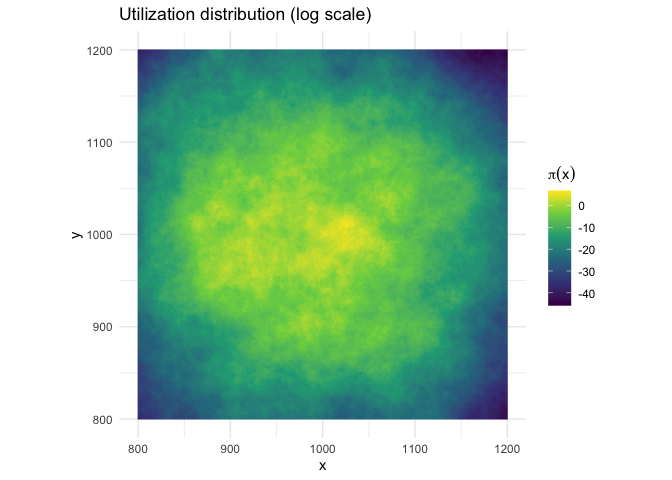<!-- -->

``` r

simDat <- simLangevin(model = "underdamped",
                      par = par,
                      spatialCovs = exampleCovs,
                      nbAnimals = 3)

head(simDat)
#>   id date   dt        x        y smaj smin eor x.err y.err     mu.x     mu.y
#> 1  1 0.00 0.00 1022.500 1007.500   NA   NA  NA    NA    NA 1022.500 1007.500
#> 2  1 0.01 0.01 1022.567 1007.561   NA   NA  NA    NA    NA 1022.567 1007.561
#> 3  1 0.02 0.01 1022.631 1007.623   NA   NA  NA    NA    NA 1022.631 1007.623
#> 4  1 0.03 0.01 1022.697 1007.684   NA   NA  NA    NA    NA 1022.697 1007.684
#> 5  1 0.04 0.01 1022.760 1007.745   NA   NA  NA    NA    NA 1022.760 1007.745
#> 6  1 0.05 0.01 1022.821 1007.804   NA   NA  NA    NA    NA 1022.821 1007.804
#>      vel.x    vel.y
#> 1 6.648996 6.362147
#> 2 6.373629 5.939960
#> 3 6.921436 6.127641
#> 4 6.312531 5.953293
#> 5 6.167376 5.889718
#> 6 6.136205 6.203144

# Simulate an underdamped Langevin diffusion path with measurement error
measurementError <- list(smaj.sd = 1.5,      # sd of semi-major axis of error ellipse
                         smin.sd = 0.75,     # sd of semi-minor axis of error ellipse
                         eor.lim = c(0,180)) # range of ellipse orientation (in degrees from north)

exampleDat <- simLangevin(model = "underdamped",
                         par = par,
                         spatialCovs = exampleCovs,
                         nbAnimals = 3,
                         obsPerAnimal = 500,
                         measurementError = measurementError)

head(exampleDat)
#>   id date   dt        x        y      smaj      smin       eor x.err y.err
#> 1  1 0.00 0.00 1022.110 1006.222 3.1904213 0.8238468 0.4407540    NA    NA
#> 2  1 0.01 0.01 1022.556 1007.536 0.2602149 0.1929297 0.8419944    NA    NA
#> 3  1 0.02 0.01 1021.444 1008.586 1.9072127 0.6294832 2.2160981    NA    NA
#> 4  1 0.03 0.01 1022.745 1007.629 0.1952989 0.0469546 2.2100417    NA    NA
#> 5  1 0.04 0.01 1023.500 1008.079 1.4343749 1.1175133 2.8685380    NA    NA
#> 6  1 0.05 0.01 1022.996 1008.430 0.8349596 0.1392169 0.4690632    NA    NA
#>       mu.x     mu.y    vel.x    vel.y
#> 1 1022.500 1007.500 6.648996 6.362147
#> 2 1022.567 1007.561 6.373629 5.939960
#> 3 1022.631 1007.623 6.921436 6.127641
#> 4 1022.697 1007.684 6.312531 5.953293
#> 5 1022.760 1007.745 6.167376 5.889718
#> 6 1022.821 1007.804 6.136205 6.203144
```

To fit the Langevin diffusion model to observed tracking data, one can
use the `formatData` and `fitLangevin` functions. For example:

``` r
# unformatDat is example data appropriate for formatData that loads with the package
head(unformatDat)
#>   id                date        x        y      smaj      smin       eor x.err
#> 1  1 2026-10-19 00:00:00 1022.110 1006.222 3.1904213 0.8238468  25.25334    NA
#> 2  1 2026-10-19 00:00:36 1022.556 1007.536 0.2602149 0.1929297  48.24272    NA
#> 3  1 2026-10-19 00:01:12 1021.444 1008.586 1.9072127 0.6294832 126.97307    NA
#> 4  1 2026-10-19 00:01:48 1022.745 1007.629 0.1952989 0.0469546 126.62606    NA
#> 5  1 2026-10-19 00:02:24 1023.500 1008.079 1.4343749 1.1175133 164.35512    NA
#> 6  1 2026-10-19 00:03:00 1022.996 1008.430 0.8349596 0.1392169  26.87534    NA
#>   y.err
#> 1    NA
#> 2    NA
#> 3    NA
#> 4    NA
#> 5    NA
#> 6    NA

# format the data for fitLangevin
exampleDat <- formatData(unformatDat, time.unit = "hours")

head(exampleDat)
#>   id                date   dt        x        y   lc      smaj      smin
#> 1  1 2026-10-19 00:00:00 0.00 1022.110 1006.222 <NA> 3.1904213 0.8238468
#> 2  1 2026-10-19 00:00:36 0.01 1022.556 1007.536 <NA> 0.2602149 0.1929297
#> 3  1 2026-10-19 00:01:12 0.01 1021.444 1008.586 <NA> 1.9072127 0.6294832
#> 4  1 2026-10-19 00:01:48 0.01 1022.745 1007.629 <NA> 0.1952989 0.0469546
#> 5  1 2026-10-19 00:02:24 0.01 1023.500 1008.079 <NA> 1.4343749 1.1175133
#> 6  1 2026-10-19 00:03:00 0.01 1022.996 1008.430 <NA> 0.8349596 0.1392169
#>         eor x.err y.err
#> 1 0.4407540    NA    NA
#> 2 0.8419944    NA    NA
#> 3 2.2160981    NA    NA
#> 4 2.2100417    NA    NA
#> 5 2.8685380    NA    NA
#> 6 0.4690632    NA    NA

# Fit the overdamped Langevin diffusion model to simulated data with measurement error
fit_over <- fitLangevin(model = "overdamped",
                   data = exampleDat,
                   spatialCovs = exampleCovs,
                   par = list(beta = rep(0,length(exampleCovs)),
                              sigma = 5),
                   getJointPrecision = TRUE)  

fit_over
#> 
#> Habitat-Driven Langevin Diffusion Model
#> =======================================
#> Model type:        Overdamped 
#> Observation model: Gaussian 
#> Convergence:       Successful 
#> Max Log-Likelihood: -2565.345 
#> Optimization time:  0.66 seconds
#> 
#> Parameter Estimates (Natural Scale):
#> ---------------------------------------
#>           Estimate Std. Error
#> beta_cov1  -3.9130      3.882
#> beta_cov2   0.5831      4.241
#> beta_cov3   9.2407      3.762
#> beta_d2c    2.4002      1.327
#> sigma       1.4617      0.042
#> rho_o       0.0000      0.000
#> tau_1       1.0000      0.000
#> tau_2       1.0000      0.000
#> psi         1.0000      0.000

# Fit the underdamped Langevin diffusion model
fit_under <- fitLangevin(model = "underdamped",
                   data = exampleDat,
                   spatialCovs = exampleCovs,
                   par = list(beta = rep(0,length(exampleCovs)),
                              sigma = 5,
                              gamma = 0.5),
                   getJointPrecision = TRUE)  

fit_under
#> 
#> Habitat-Driven Langevin Diffusion Model
#> =======================================
#> Model type:        Underdamped 
#> Observation model: Gaussian 
#> Convergence:       Successful 
#> Max Log-Likelihood: -2052.928 
#> Optimization time:  1.67 seconds
#> 
#> Parameter Estimates (Natural Scale):
#> ---------------------------------------
#>           Estimate Std. Error
#> beta_cov1  -4.3847      1.209
#> beta_cov2   5.6774      1.480
#> beta_cov3   5.4978      1.420
#> beta_d2c   -0.2021      0.191
#> sigma       4.7914      0.561
#> gamma       0.4206      0.102
#> rho_o       0.0000      0.000
#> tau_1       1.0000      0.000
#> tau_2       1.0000      0.000
#> psi         1.0000      0.000
```

### Post-processing functions

#### Utilization distribution

``` r
# calculate the estimated UD
UD <- getUD(spatialCovs = exampleCovs, 
            fit = fit_under, 
            nSims = 1000, # Monte Carlo simulation
            show_progress = FALSE)
```

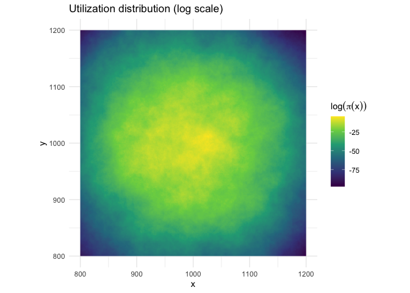<!-- -->

``` r

p_UD <- plotUD(UD)

# UD relative uncertainty (Delta method approximation)
p_UD$CV_delta
```

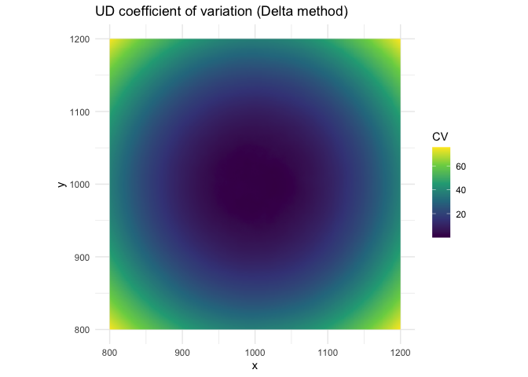<!-- -->

``` r

# UD relative uncertainty (Monte Carlo simulation)
p_UD$CV_sim
```

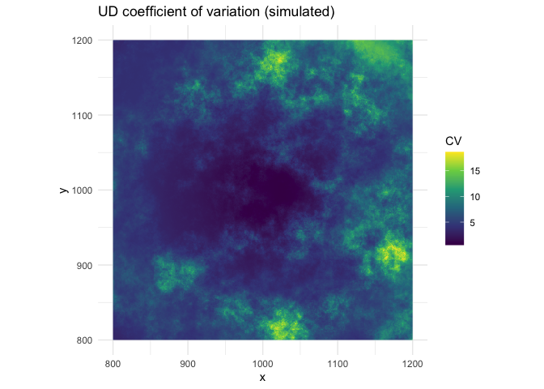<!-- -->

``` r

# plot the estimated (log) UD with the observed and estimated locations
plot(fit_under, spatialCovs = exampleCovs, data = exampleDat)
```

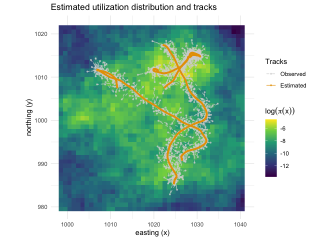<!-- -->

#### Other S3 methods for `fitLangevin` objects

``` r
# fixed effect estimates
coef(fit_under) 
#>  beta_cov1  beta_cov2  beta_cov3   beta_d2c      sigma      gamma      rho_o 
#> -4.3846853  5.6773953  5.4977716 -0.2021206  4.7914372  0.4205945  0.0000000 
#>      tau_1      tau_2        psi 
#>  1.0000000  1.0000000  1.0000000

# confidence intervals for fixed effects
confint(fit_under) 
#>                2.5 %     97.5 %
#> beta_cov1 -6.7542762 -2.0150945
#> beta_cov2  2.7775995  8.5771911
#> beta_cov3  2.7136445  8.2818987
#> beta_d2c  -0.5758764  0.1716353
#> sigma      3.6914830  5.8913915
#> gamma      0.2203201  0.6208689
#> rho_o      0.0000000  0.0000000
#> tau_1      1.0000000  1.0000000
#> tau_2      1.0000000  1.0000000
#> psi        1.0000000  1.0000000

# confidence intervals for true locations
mu_ci <- confint(fit_under, parm= "mu") 

head(mu_ci)
#>   id                date mu.x_2.5% mu.x_97.5% mu.y_2.5% mu.y_97.5%
#> 1  1 2026-10-19 00:00:00  1022.303   1022.599  1007.436   1007.688
#> 2  1 2026-10-19 00:00:36  1022.379   1022.637  1007.503   1007.725
#> 3  1 2026-10-19 00:01:12  1022.452   1022.678  1007.569   1007.765
#> 4  1 2026-10-19 00:01:48  1022.522   1022.721  1007.632   1007.808
#> 5  1 2026-10-19 00:02:24  1022.590   1022.767  1007.693   1007.856
#> 6  1 2026-10-19 00:03:00  1022.656   1022.815  1007.751   1007.908

# AIC for comparing models with different fixed effects
AIC(fit_under) 
#> [1] 4117.855

# BIC for comparing models with different fixed effects
BIC(fit_under) 
#> [1] 4149.735
```

#### One-step-ahead residuals

``` r
# calculate one-step-ahead residuals for model diagnostics
res_under <- residuals(fit_under, data = exampleDat, spatialCovs = exampleCovs, ncores = 3)
res_under
#> 
#> === One-Step-Ahead (OSA) Residuals ===
#> Total observations: 1500 
#> Number of tracks:   3 
#> 
#> ---- Goodness-of-Fit Tests ----
#>        metric   statistic    p.value     effect
#>          KS_x  0.01551682 0.86380215 0.01551682
#>          KS_y  0.02147667 0.49469495 0.02147667
#>  KS_mah_shape  0.01045172 0.98601399 0.01045172
#>      Disp_mah  1.03983111 0.12609172 0.03983111
#>          LB_x 29.02794604 0.04803859 0.03761503
#>          LB_y  9.32341333 0.95177335 0.03351905
#>        LB_mah 13.96188585 0.73157248 0.06221109
#> With many residuals, judge the effect size, not only the p-value. See ?residuals.fitLangevin.
#> -------------------------------
#> 
#> Residual Summary:
#>    residual.x          residual.y      
#>  Min.   :-3.111374   Min.   :-3.56724  
#>  1st Qu.:-0.676653   1st Qu.:-0.65359  
#>  Median : 0.004320   Median : 0.01415  
#>  Mean   : 0.008531   Mean   : 0.01686  
#>  3rd Qu.: 0.692407   3rd Qu.: 0.71819  
#>  Max.   : 3.038999   Max.   : 2.94405  
#>  NA's   :3           NA's   :3

# plot residuals to check model fit
p_under <- plot(res_under)
p_under$qq_x + p_under$qq_y + p_under$acf_x + p_under$acf_y + plot_layout(ncol=2)
```

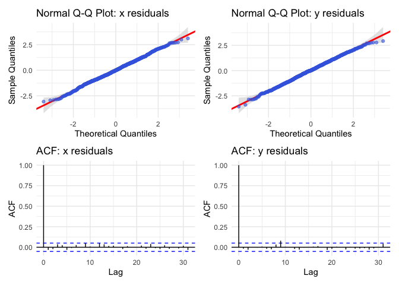<!-- -->

``` r

# can be used to compare "underdamped" vs "overdamped" models
res_over <- residuals(fit_over, data = exampleDat, spatialCovs = exampleCovs, ncores = 3)
res_over
#> 
#> === One-Step-Ahead (OSA) Residuals ===
#> Total observations: 1500 
#> Number of tracks:   3 
#> 
#> ---- Goodness-of-Fit Tests ----
#>        metric   statistic      p.value      effect
#>          KS_x  0.01362424 9.438968e-01  0.01362424
#>          KS_y  0.04536815 4.214138e-03  0.04536815
#>  KS_mah_shape  0.02013002 3.496503e-01  0.02013002
#>      Disp_mah  0.95644950 8.885458e-02 -0.04355050
#>          LB_x 74.75258830 6.979523e-09  0.09694150
#>          LB_y 26.51342346 8.858512e-02  0.06082852
#>        LB_mah 21.44850134 2.573921e-01  0.07982916
#> With many residuals, judge the effect size, not only the p-value. See ?residuals.fitLangevin.
#> -------------------------------
#> 
#> Residual Summary:
#>    residual.x          residual.y      
#>  Min.   :-3.001686   Min.   :-3.32560  
#>  1st Qu.:-0.652739   1st Qu.:-0.56429  
#>  Median : 0.005771   Median : 0.08328  
#>  Mean   :-0.003423   Mean   : 0.07084  
#>  3rd Qu.: 0.658694   3rd Qu.: 0.69843  
#>  Max.   : 2.702959   Max.   : 3.16896  
#>  NA's   :3           NA's   :3

p_over <- plot(res_over)
p_over$qq_x + p_over$qq_y + p_over$acf_x + p_over$acf_y + plot_layout(ncol=2)
```

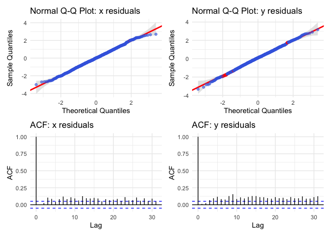<!-- -->

#### Conditional AIC

``` r
# calculate conditional AIC of Zheng et al. (2024)
cAIC(fit_under, data = exampleDat, spatialCovs = exampleCovs, nSims = 1000)
#> 
#> Conditional Akaike Information Criterion (cAIC)
#> ===============================================
#> cAIC:                  3516.29
#> Conditional NLL:       1576.60
#> -----------------------------------------------
#> Effective DF (EDF):    175.55
#> Trace Penalty:         5824.45
#> Fixed Effects (p):     6
#> Random Effects (q):    6000

cAIC(fit_over, data = exampleDat, spatialCovs = exampleCovs, nSims = 1000)
#> 
#> Conditional Akaike Information Criterion (cAIC)
#> ===============================================
#> cAIC:                  4344.15
#> Conditional NLL:       1453.15
#> -----------------------------------------------
#> Effective DF (EDF):    713.92
#> Trace Penalty:         2286.08
#> Fixed Effects (p):     5
#> Random Effects (q):    3000
```

#### Bhattacharyya’s affinity

``` r
# calculate similarity of true and estimated UDs using Bhattacharyya's affinity
rasterOverlap(exp(UD), exp(trueUD))
#> [1] 0.9466614
```

#### Regional presence probability

``` r
# create a spatial mask for the region of interest
d2c <- exampleCovs$d2c < 2.5

reg_prob <- regionProb(fit_under,
                       spatialCovs = exampleCovs, 
                       mask = d2c, # region of interest
                       nSims = 1000, # number of Monte Carlo simulations
                       show_progress = FALSE)

reg_prob
#> Regional Probability Estimate
#> =============================
#> Point Estimate: 0.3403
#> 
#> Delta Method Approximation:
#>   Standard Error: 0.1602
#>   95% CI:         [0.0263, 0.6543]
#> 
#> Monte Carlo Simulation:
#>   Standard Error: 0.1913
#>   95% CI:         [0.0000, 0.6288]
#>   (Based on 1000 draws)

plot(reg_prob, log = TRUE)
```

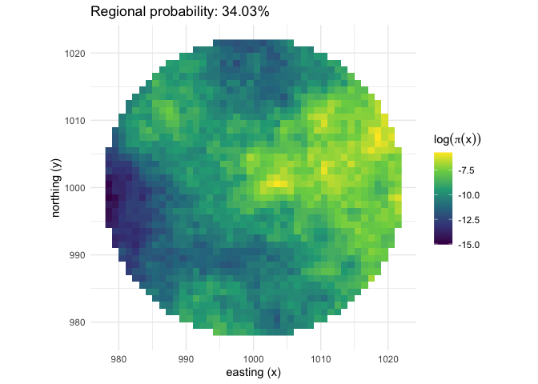<!-- -->

### Spatial constraints (i.e., barriers)

To include barriers to movement (e.g., land for marine animals), the
`prepBarrier` function can be used to create a signed distance field
(SDF) from a binary raster mask (where 1 indicates allowed movement
areas and 0 indicates restricted movement areas) or polygons (as
`sf',`sfc’, or
`SpatVector-class' objects). When included in`spatialCovs`and identified by the`barrier`argument in`simLangevin`and`fitLangevin`, the SDF is then included as part of a penalty term with strength`lambda\`:

``` r
# create a dummy barrier mask (left half restricted = 0, right half allowed = 1)
coast_barrier <- exampleCovs[[1]]
terra::values(coast_barrier) <- ifelse(terra::crds(coast_barrier)[, "x"]
                                       >= mean(terra::crds(coast_barrier)[, "x"]), 1, 0)
names(coast_barrier) <- "coast_barrier"

# convert mask to SDF and add to the spatial covariates list
# maskBuffer adds 1 cell buffer to barrier
exampleCovs_barrier <- exampleCovs
maskBuff <- maskBuffer(coast_barrier,bufferCells=1)
#> Warning: [distance] unknown CRS. Results can be wrong
exampleCovs_barrier$coast_barrier <- prepBarrier(maskBuff)
exampleCovs_barrier$d2coast <- exampleCovs_barrier$coast_barrier

# add a beta coefficient for d2c to the parameter list
# negative value indicates slight attraction to the "coast"
par_barrier <- par
par_barrier$beta <- c(par_barrier$beta, -0.15)

# simulate the data
simDat_barrier <- simLangevin(par = par_barrier,
                              nbAnimals = 3,
                              spatialCovs = exampleCovs_barrier,
                              barrier = "coast_barrier",
                              measurementError = list(smaj.sd = 4,
                                                      smin.sd = 1,
                                                      eor.lim = c(0,180)))

fit_barrier <- fitLangevin(data = simDat_barrier,
                           spatialCovs = exampleCovs_barrier,
                           lambda = 4.003)
fit_barrier
#> 
#> Habitat-Driven Langevin Diffusion Model
#> =======================================
#> Model type:        Underdamped 
#> Observation model: Gaussian 
#> Convergence:       Successful 
#> Max Log-Likelihood: -3760.144 
#> Optimization time:  1.73 seconds
#> Barrier penalty:    4.003 
#> 
#> Parameter Estimates (Natural Scale):
#> ---------------------------------------
#>               Estimate Std. Error
#> beta_cov1    -3.755564      0.846
#> beta_cov2     5.800506      0.881
#> beta_cov3     6.528340      0.864
#> beta_d2c     -0.001507      0.522
#> beta_d2coast -0.117922      0.088
#> sigma         4.835697      0.188
#> gamma         0.576948      0.079
#> rho_o         0.000000      0.000
#> tau_1         1.000000      0.000
#> tau_2         1.000000      0.000
#> psi           1.000000      0.000

plot(fit_barrier, data = simDat_barrier,
                  spatialCovs = exampleCovs_barrier,
                  maskRast = coast_barrier)
```

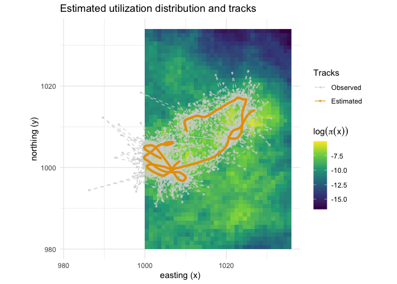<!-- -->

``` r

# if lambda is not known, it can be tied to the movement parameters or estimated

fit_barrier_tied <- fitLangevin(data = simDat_barrier,
                                spatialCovs = exampleCovs_barrier,
                                lambda = "tied")
fit_barrier_tied
#> 
#> Habitat-Driven Langevin Diffusion Model
#> =======================================
#> Model type:        Underdamped 
#> Observation model: Gaussian 
#> Convergence:       Successful 
#> Max Log-Likelihood: -3759.641 
#> Optimization time:  1.73 seconds
#> Barrier penalty:    tied
#> 
#> Parameter Estimates (Natural Scale):
#> ---------------------------------------
#>              Estimate Std. Error
#> beta_cov1    -2.87398      0.745
#> beta_cov2     4.47855      0.852
#> beta_cov3     4.98241      0.983
#> beta_d2c     -0.07326      0.412
#> beta_d2coast -0.07966      0.074
#> sigma         5.50423      0.391
#> gamma         0.45408      0.038
#> rho_o         0.00000      0.000
#> tau_1         1.00000      0.000
#> tau_2         1.00000      0.000
#> psi           1.00000      0.000
#> lambda        2.99985      0.593

plot(fit_barrier_tied, data = simDat_barrier,
                       spatialCovs = exampleCovs_barrier,
                       maskRast = coast_barrier)
```

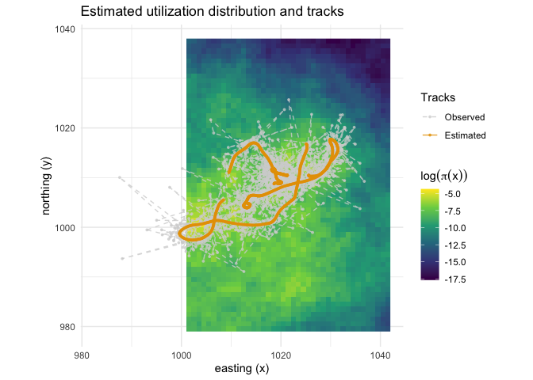<!-- -->

``` r

fit_barrier_est <- fitLangevin(data = simDat_barrier,
                               spatialCovs = exampleCovs_barrier,
                               lambda = "estimate")
fit_barrier_est
#> 
#> Habitat-Driven Langevin Diffusion Model
#> =======================================
#> Model type:        Underdamped 
#> Observation model: Gaussian 
#> Convergence:       Successful 
#> Max Log-Likelihood: -3759.607 
#> Optimization time:  1.94 seconds
#> Barrier penalty:    estimate
#> 
#> Parameter Estimates (Natural Scale):
#> ---------------------------------------
#>              Estimate Std. Error
#> beta_cov1    -3.02677      0.976
#> beta_cov2     4.71246      1.260
#> beta_cov3     5.23261      1.398
#> beta_d2c     -0.07700      0.435
#> beta_d2coast -0.08249      0.079
#> sigma         5.36772      0.626
#> gamma         0.48240      0.116
#> rho_o         0.00000      0.000
#> tau_1         1.00000      0.000
#> tau_2         1.00000      0.000
#> psi           1.00000      0.000
#> lambda        3.13142      0.789

plot(fit_barrier_est, data = simDat_barrier,
                         spatialCovs = exampleCovs_barrier,
                         maskRast = coast_barrier)
```

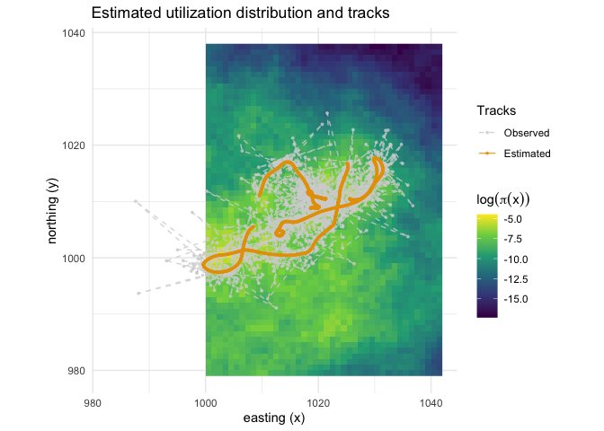<!-- -->

## Citation

If you use `{langevinSSM}` in your research, please cite it as follows:

    To cite package 'langevinSSM' in publications use:

      Dupont, F., McClintock, B.T., Fischer, J.-O., Marcoux, M., Hussey,
      N., and Auger-Méthé, M. (2026). Inferring resource selection and
      utilization distributions from irregular and error-prone animal
      tracking data. arXiv:2606.12566.

    A BibTeX entry for LaTeX users is

      @Article{,
        title = {Inferring resource selection and utilization distributions from irregular and error-prone animal tracking data},
        author = {Fanny Dupont and Brett T. McClintock and Jan-Ole Fischer and Marianne Marcoux and Nigel Hussey and Marie Auger-Méthé},
        journal = {arXiv},
        year = {2026},
        eprint = {2606.12566},
        primaryclass = {stat.ME},
        url = {https://arxiv.org/abs/2606.12566},
      }

    Additions and modifications to langevinSSM are frequent, to help with
    reproducibility of output please cite its version number. This is
    'langevinSSM' version 0.0.2
